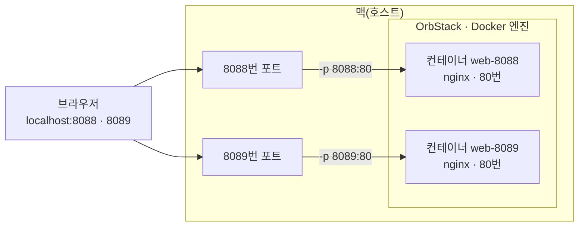
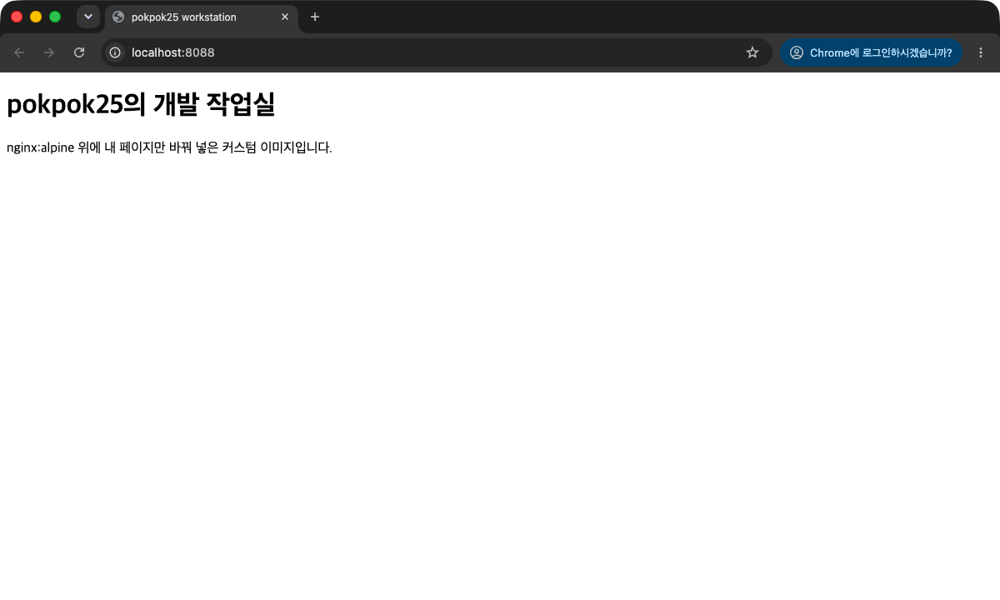
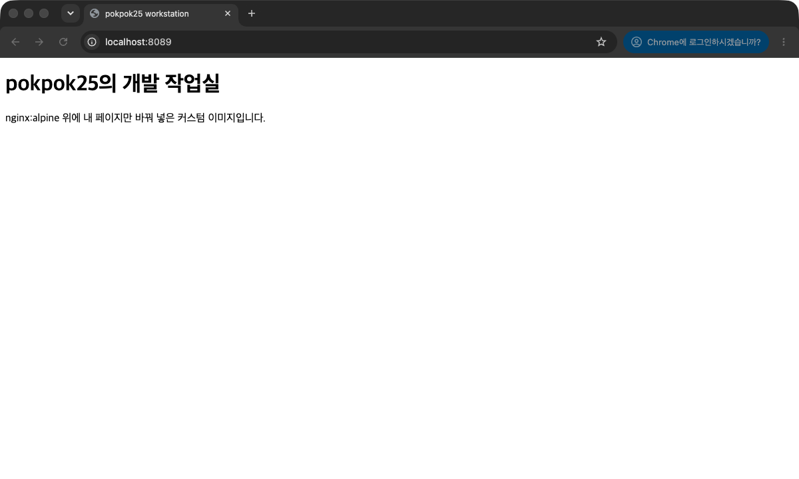
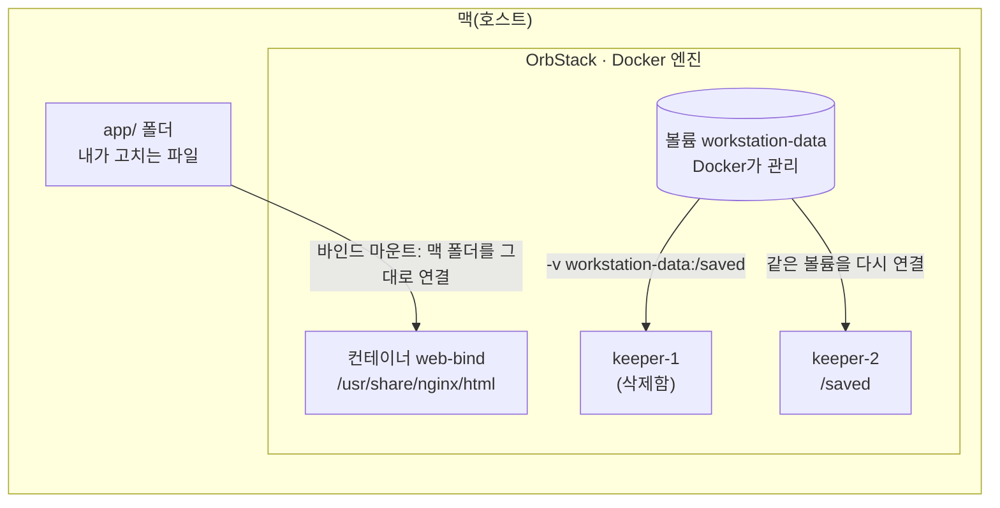

# e1-1-workstation

코디세이 E1-1 미션 「내 컴퓨터에 개발자용 '작업실' 꾸미기」 — 터미널 · 권한 · Docker · Git을 내 맥에서 직접 세팅하고, 실행 결과(로그 · 접속 · 데이터 유지)로 검증한 기록.

## 목차

1. [프로젝트 개요](#1-프로젝트-개요)
2. [실행 환경](#2-실행-환경)
3. [수행 체크리스트](#3-수행-체크리스트)
4. [터미널 조작 로그](#4-터미널-조작-로그)
5. [권한 실습](#5-권한-실습)
6. [Docker 설치 점검](#6-docker-설치-점검)
7. [Docker 기본 운영](#7-docker-기본-운영)
8. [컨테이너 실습](#8-컨테이너-실습)
9. [커스텀 이미지](#9-커스텀-이미지)
10. [포트 매핑 접속](#10-포트-매핑-접속)
11. [바인드 마운트](#11-바인드-마운트)
12. [볼륨 영속성](#12-볼륨-영속성)
13. [Git 설정과 GitHub VSCode 연동](#13-git-설정과-github-vscode-연동)
14. [검증 방법 요약](#14-검증-방법-요약)
15. [트러블슈팅](#15-트러블슈팅)
16. [보안 점검](#16-보안-점검)
17. [설계 원칙과 환경 주의](#17-설계-원칙과-환경-주의)

## 1. 프로젝트 개요

- **목표**: 코드가 「내 컴퓨터에서만」 돌아가는 문제를 줄이고, 누가 실행해도 같은 결과가 나오는(재현 가능한) 개발 환경을 직접 꾸민다.
- **한 일**: 터미널로 작업 폴더와 권한을 정리하고, Docker(OrbStack)를 설치 · 점검한 뒤 컨테이너를 실행 · 관리했다. 웹 서버를 Dockerfile로 커스텀 이미지로 만들어 포트 매핑으로 접속하고, 바인드 마운트로 「변경 반영」, 볼륨으로 「데이터 영속성」을 확인했다. Git 설정과 GitHub · VSCode 연동까지 마쳤다.
- **재현 방법**: 저장소를 받아(`git clone https://github.com/pokpok25/e1-1-workstation.git`) 그 폴더로 들어간 뒤, 4절부터 순서대로 따라 치면 같은 결과를 볼 수 있다(맥 · OrbStack 기준 — 다른 환경은 17절).

```
e1-1-workstation/
├── README.md            ← 이 문서(모든 수행 로그와 증거)
├── Dockerfile           ← 커스텀 이미지 정의(9절)
├── app/
│   ├── index.html       ← 웹 서버가 보여 줄 페이지(9절)
│   └── bind-check.txt   ← 바인드 마운트 확인용(11절)
├── terminal-lab/        ← 터미널 · 권한 실습 폴더(4 · 5절)
└── docs/
    └── images/          ← 스크린샷(10 · 13절)
```

## 2. 실행 환경

| 항목 | 값 |
|---|---|
| OS | macOS 26.5.2 (빌드 25F84) |
| 셸 | zsh 5.9 (`/bin/zsh`) |
| 터미널 | VSCode 내장 터미널 (`TERM_PROGRAM=vscode`) |
| Docker | Docker version 29.8.2 (OrbStack) |
| Git | git version 2.50.1 (Apple Git-155) |

로그의 `$`는 프롬프트를 줄여 적은 것이다(셸은 zsh).

<details>
<summary>확인 명령과 출력</summary>

```
$ sw_vers
ProductName:            macOS
ProductVersion:         26.5.2
BuildVersion:           25F84
$ echo $SHELL
/bin/zsh
$ zsh --version
zsh 5.9 (arm64-apple-darwin25.0)
$ echo $TERM_PROGRAM
vscode
$ git --version
git version 2.50.1 (Apple Git-155)
$ docker --version
Docker version 29.8.2, build 7fc2dff
```

</details>

## 3. 수행 체크리스트

- [x] 터미널: 위치 · 목록 · 이동 · 생성 · 복사 · 이름변경 · 삭제 · 내용 확인 · 빈 파일 → [4절](#4-터미널-조작-로그)
- [x] 권한: 파일 1개 · 디렉토리 1개 변경 전/후 → [5절](#5-권한-실습)
- [x] Docker: 설치 점검 · 기본 운영 · 컨테이너 실습 → [6절](#6-docker-설치-점검) · [7절](#7-docker-기본-운영) · [8절](#8-컨테이너-실습)
- [x] Dockerfile: 커스텀 이미지 빌드 · 실행 → [9절](#9-커스텀-이미지)
- [x] 포트: `-p`로 두 포트 접속 → [10절](#10-포트-매핑-접속)
- [x] 마운트: 바인드 마운트로 호스트 변경 반영 → [11절](#11-바인드-마운트)
- [x] 볼륨: 컨테이너 삭제 뒤 데이터 유지 → [12절](#12-볼륨-영속성)
- [x] Git: 사용자 정보 · 기본 브랜치 설정 → [13절](#13-git-설정과-github-vscode-연동)
- [ ] GitHub: VSCode 로그인 · 저장소 연동 → [13절](#13-git-설정과-github-vscode-연동)

## 4. 터미널 조작 로그

**이동 · 생성 · 현재 위치 · 목록**

```
$ cd ~/codyssey/e1-1-workstation
$ mkdir -p terminal-lab/backup
$ cd terminal-lab
$ pwd
/Users/jmac/codyssey/e1-1-workstation/terminal-lab
$ ls -la
total 0
drwxr-xr-x@ 3 jmac  staff   96 Nov  8 15:07 .
drwxr-xr-x@ 5 jmac  staff  160 Nov  8 15:07 ..
drwxr-xr-x@ 2 jmac  staff   64 Nov  8 15:07 backup
```

**빈 파일 생성 · 파일 내용 확인**

```
$ touch empty.txt
$ echo "my first terminal log" > memo.txt
$ cat memo.txt
my first terminal log
```
- touch - 수정 시각을 지금으로 바꿔줌 파일이 없을 경우 빈 파일 생성
- echo가 글자를 내보내고 리다이렉션 `>` 로 "my first terminal log" 적힌 memo.txt 생성
- cat 명령어로 memo.txt 의 내용인 "my first terminal log" 출력

**숨김 파일 포함 목록** — `ls`와 `ls -la` 비교

```
$ touch .hidden-note
$ ls
backup          empty.txt       memo.txt
$ ls -la
total 8
drwxr-xr-x@ 6 jmac  staff  192 Nov 10 16:55 .
drwxr-xr-x@ 5 jmac  staff  160 Nov  8 15:07 ..
-rw-r--r--@ 1 jmac  staff    0 Nov 10 16:55 .hidden-note
drwxr-xr-x@ 2 jmac  staff   64 Nov  8 15:07 backup
-rw-r--r--@ 1 jmac  staff    0 Nov 10 16:43 empty.txt
-rw-r--r--@ 1 jmac  staff   22 Nov 10 16:43 memo.txt
```
- `ls`에는 .hidden-note 이 보이지 않고 `ls -la`에는 보인다, -a 가 .으로 시작되는 숨겨진 파일도 모두 나타내게 한다
- `ls -la`에서 empty.txt 크기가 0 → 빈 파일이 만들어졌다

**복사 · 이동/이름변경 · 삭제**

```
$ cp memo.txt backup/
$ ls -la backup
total 8
drwxr-xr-x@ 3 jmac  staff   96 Nov 10 16:58 .
drwxr-xr-x@ 6 jmac  staff  192 Nov 10 16:55 ..
-rw-r--r--@ 1 jmac  staff   22 Nov 10 16:58 memo.txt
$ mv empty.txt blank.txt
$ ls -la
total 8
drwxr-xr-x@ 6 jmac  staff  192 Nov 10 20:04 .
drwxr-xr-x@ 5 jmac  staff  160 Nov  8 15:07 ..
-rw-r--r--@ 1 jmac  staff    0 Nov 10 16:55 .hidden-note
drwxr-xr-x@ 3 jmac  staff   96 Nov 10 16:58 backup
-rw-r--r--@ 1 jmac  staff    0 Nov 10 16:43 blank.txt
-rw-r--r--@ 1 jmac  staff   22 Nov 10 16:43 memo.txt
$ rm blank.txt
$ ls -la
total 8
drwxr-xr-x@ 5 jmac  staff  160 Nov 10 20:05 .
drwxr-xr-x@ 5 jmac  staff  160 Nov  8 15:07 ..
-rw-r--r--@ 1 jmac  staff    0 Nov 10 16:55 .hidden-note
drwxr-xr-x@ 3 jmac  staff   96 Nov 10 16:58 backup
-rw-r--r--@ 1 jmac  staff   22 Nov 10 16:43 memo.txt
```
- cp : backup 폴더 안에 memo.txt 복사본이 생겼고 원본과 용량이 같다.
- mv : empty.txt가 blank.txt로 바뀌었다 → 같은 폴더 안에서 mv는 이름 바꾸기
- rm : 지운 뒤 blank.txt 줄이 목록에서 사라졌다

**이동 전후 위치**

```
$ cd backup
$ pwd
/Users/jmac/codyssey/e1-1-workstation/terminal-lab/backup
$ cd ..
$ pwd
/Users/jmac/codyssey/e1-1-workstation/terminal-lab
```

- 두 pwd의 끝이 `terminal-lab/backup`에서 `terminal-lab`으로 바뀌었다 → `cd backup` · `cd ..`은 지금 위치를 기준으로 움직이는 **상대 경로**이고, pwd가 보여 주는 `/`부터 시작하는 경로는 어디서 써도 같은 곳을 가리키는 **절대 경로**다.

## 5. 권한 실습

**파일 1개 — 실행 권한 주기**(`terminal-lab` 안에서)

```
$ echo '#!/bin/sh' > hello.sh
$ echo 'echo hello from script' >> hello.sh
$ ls -l hello.sh
-rw-r--r--@ 1 jmac  staff  33 Nov 10 21:09 hello.sh
$ ./hello.sh
zsh: permission denied: ./hello.sh
$ chmod 755 hello.sh
$ ls -l hello.sh
-rwxr-xr-x@ 1 jmac  staff  33 Nov 10 21:09 hello.sh
$ ./hello.sh
hello from script
```
- 바꾸기 전 `-rw-r--r--`(644)라 실행(x)이 없어 `./hello.sh`가 `permission denied` → `chmod 755` 뒤 `-rwxr-xr-x`로 x가 생겨 실행됐다(`hello from script`)

**디렉토리 1개 — 나만 쓰게 바꾸기**

```
$ ls -ld backup
drwxr-xr-x@ 3 jmac  staff  96 Nov 10 16:58 backup
$ chmod 700 backup
$ ls -ld backup
drwx------@ 3 jmac  staff  96 Nov 10 16:58 backup
```
- 바꾸기 전 `drwxr-xr-x`(755) → `chmod 700` 뒤 `drwx------` — 그룹 · 기타의 r · x가 사라져 나만 읽고 · 쓰고 · 들어갈 수 있다

| 숫자 | 글자 | 뜻 |
|---|---|---|
| `644` | `rw-r--r--` | 소유자 6(r+w) · 그룹 4(r) · 기타 4(r) |
| `755` | `rwxr-xr-x` | 소유자 7(r+w+x) · 그룹 5(r+x) · 기타 5(r+x) |
| `700` | `rwx------` | 소유자만 읽기 · 쓰기 · 들어가기(디렉토리의 x = 안으로 들어감) |

r=4 · w=2 · x=1을 소유자 · 그룹 · 기타 세 자리로 더한다.

## 6. Docker 설치 점검

OrbStack 앱을 켜면 Docker 엔진이 함께 실행되고, 터미널에서 `docker` 명령을 그대로 쓴다.

```
$ docker --version
Docker version 29.8.2, build 7fc2dff
```

- `docker --version` → 내가 치는 `docker` 명령 프로그램(클라이언트) 29.8.2가 설치돼 있다
- `docker info`의 `Server:` 아래 `Server Version: 29.8.2` · `Operating System: OrbStack` · `OSType: linux`가 나왔다 → Docker 엔진(데몬)이 OrbStack 속 리눅스에서 돌고 있다(엔진이 꺼져 있으면 `Server:` 대신 에러가 난다)

<details>
<summary>docker info — 데몬 동작 확인(Server 부분)</summary>

```
$ docker info
Client:
 Version:    29.8.2
 Context:    orbstack
 Debug Mode: false
 Plugins:
  buildx: Docker Buildx (Docker Inc.)
    Version:  v0.37.2
    Path:     /Users/jmac/.docker/cli-plugins/docker-buildx
  compose: Docker Compose (Docker Inc.)
    Version:  v5.5.0
    Path:     /Users/jmac/.docker/cli-plugins/docker-compose

Server:
 Containers: 2
  Running: 0
  Paused: 0
  Stopped: 2
 Images: 2
 Server Version: 29.8.2
 Storage Driver: overlayfs
  driver-type: io.containerd.snapshotter.v1
 Logging Driver: json-file
 Cgroup Driver: cgroupfs
 Cgroup Version: 2
 Plugins:
  Volume: local
  Network: bridge host ipvlan macvlan null overlay
  Log: awslogs fluentd gcplogs gelf journald json-file local splunk syslog
 CDI spec directories:
  /etc/cdi
  /var/run/cdi
 Swarm: inactive
 Runtimes: io.containerd.runc.v2 runc
 Default Runtime: runc
 Init Binary: docker-init
 containerd version: ee2735368117d2eb259779949d5e75cdafec9761
 runc version: 29dd3dc2b13b4123162e5fe132504bb4b15569f1
 init version: de40ad0
 Security Options:
  seccomp
   Profile: builtin
  cgroupns
 Kernel Version: 7.2.12-orbstack-00394-gbecdd6130068
 Operating System: OrbStack
 OSType: linux
 Architecture: aarch64
 CPUs: 12
 Total Memory: 15.66GiB
 Name: orbstack
 ID: cd3d9065-e724-4633-a46c-cd03cdeae7cf
 Docker Root Dir: /var/lib/docker
 Debug Mode: false
 HTTP Proxy: http://proxy.orb.internal:8305
 HTTPS Proxy: http://proxy.orb.internal:8305
 No Proxy: localhost,127.0.0.1,127.0.0.0/8,::1,10.0.0.0/8,172.16.0.0/12,192.168.0.0/16,0.250.250.0/24,*.orb.internal,*.local,gateway.docker.internal,host.internal,host.docker.internal,host.lima.internal,docker.for.mac.localhost,docker.for.mac.host.internal
 Experimental: true
 Insecure Registries:
  127.0.0.0/8
  ::1/128
 Live Restore Enabled: false
 Product License: Community Engine
 Default Address Pools:
   Base: 192.168.97.0/24, Size: 24
   Base: 192.168.107.0/24, Size: 24
   Base: 192.168.117.0/24, Size: 24
   Base: 192.168.147.0/24, Size: 24
   Base: 192.168.148.0/24, Size: 24
   Base: 192.168.155.0/24, Size: 24
   Base: 192.168.156.0/24, Size: 24
   Base: 192.168.158.0/24, Size: 24
   Base: 192.168.163.0/24, Size: 24
   Base: 192.168.164.0/24, Size: 24
   Base: 192.168.165.0/24, Size: 24
   Base: 192.168.166.0/24, Size: 24
   Base: 192.168.167.0/24, Size: 24
   Base: 192.168.171.0/24, Size: 24
   Base: 192.168.172.0/24, Size: 24
   Base: 192.168.181.0/24, Size: 24
   Base: 192.168.183.0/24, Size: 24
   Base: 192.168.186.0/24, Size: 24
   Base: 192.168.207.0/24, Size: 24
   Base: 192.168.214.0/24, Size: 24
   Base: 192.168.215.0/24, Size: 24
   Base: 192.168.216.0/24, Size: 24
   Base: 192.168.223.0/24, Size: 24
   Base: 192.168.227.0/24, Size: 24
   Base: 192.168.228.0/24, Size: 24
   Base: 192.168.229.0/24, Size: 24
   Base: 192.168.237.0/24, Size: 24
   Base: 192.168.239.0/24, Size: 24
   Base: 192.168.242.0/24, Size: 24
   Base: 192.168.247.0/24, Size: 24
   Base: fd07:b51a:cc66:d000::/56, Size: 64
 Firewall Backend: iptables
  EnableUserlandProxy: true
  UserlandProxyPath: /opt/orbstack-guest/pstub

WARNING: DOCKER_INSECURE_NO_IPTABLES_RAW is set
```

</details>

## 7. Docker 기본 운영

**이미지 받기 · 목록**

<details>
<summary>docker pull 출력</summary>

```
$ docker pull nginx:alpine
alpine: Pulling from library/nginx
f4a8c3eaf855: Pull complete 
5faf28e117a4: Pull complete 
a6fb6399df14: Pull complete 
1b5b466c140b: Pull complete 
b25486411ab9: Pull complete 
89c6596257b9: Pull complete 
b90627b8f429: Pull complete 
66eb34db8c04: Pull complete 
8dcd939ce874: Download complete 
eeedce541506: Download complete 
Digest: sha256:713fc2ebfd92e8217db451477182ee91944b123d2b1ee9fd5a8c6e91ca6c3a11
Status: Downloaded newer image for nginx:alpine
docker.io/library/nginx:alpine
```

</details>

```
$ docker images
                                                                                                                             i Info →   U  In Use
IMAGE           ID             DISK USAGE   CONTENT SIZE   EXTRA
alpine:latest   be2656061b53       14.6MB         4.28MB    U   
nginx:alpine    713fc2ebfd92       95.3MB         27.2MB        
nginx:latest    5ab5b0b01097        261MB         65.1MB    U   
```

**컨테이너 실행 · 목록 · 로그 · 자원 · 중지**

```
$ docker run -d --name ops-nginx nginx:alpine
ecf497f05a450d62fa4b5dd11fca42fdb9a67f70b34cd74033ced822680ec135
$ docker ps
CONTAINER ID   IMAGE          COMMAND                  CREATED          STATUS          PORTS     NAMES
ecf497f05a45   nginx:alpine   "/docker-entrypoint.…"   14 seconds ago   Up 17 seconds   80/tcp    ops-nginx
```

<details>
<summary>docker logs 출력</summary>

```
$ docker logs ops-nginx
/docker-entrypoint.sh: /docker-entrypoint.d/ is not empty, will attempt to perform configuration
/docker-entrypoint.sh: Looking for shell scripts in /docker-entrypoint.d/
/docker-entrypoint.sh: Launching /docker-entrypoint.d/10-listen-on-ipv6-by-default.sh
10-listen-on-ipv6-by-default.sh: info: Getting the checksum of /etc/nginx/conf.d/default.conf
10-listen-on-ipv6-by-default.sh: info: Enabled listen on IPv6 in /etc/nginx/conf.d/default.conf
/docker-entrypoint.sh: Sourcing /docker-entrypoint.d/15-local-resolvers.envsh
/docker-entrypoint.sh: Launching /docker-entrypoint.d/20-envsubst-on-templates.sh
/docker-entrypoint.sh: Launching /docker-entrypoint.d/30-tune-worker-processes.sh
/docker-entrypoint.sh: Configuration complete; ready for start up
2026/11/10 13:54:15 [notice] 1#1: using the "epoll" event method
2026/11/10 13:54:15 [notice] 1#1: nginx/1.31.8
2026/11/10 13:54:15 [notice] 1#1: built by gcc 15.2.0 (Alpine 15.2.0) 
2026/11/10 13:54:15 [notice] 1#1: OS: Linux 7.2.12-orbstack-00394-gbecdd6130068
2026/11/10 13:54:15 [notice] 1#1: getrlimit(RLIMIT_NOFILE): 20480:1048576
2026/11/10 13:54:15 [notice] 1#1: start worker processes
2026/11/10 13:54:15 [notice] 1#1: start worker process 29
2026/11/10 13:54:15 [notice] 1#1: start worker process 30
2026/11/10 13:54:15 [notice] 1#1: start worker process 31
2026/11/10 13:54:15 [notice] 1#1: start worker process 32
2026/11/10 13:54:15 [notice] 1#1: start worker process 33
2026/11/10 13:54:15 [notice] 1#1: start worker process 34
2026/11/10 13:54:15 [notice] 1#1: start worker process 35
2026/11/10 13:54:15 [notice] 1#1: start worker process 36
2026/11/10 13:54:15 [notice] 1#1: start worker process 37
2026/11/10 13:54:15 [notice] 1#1: start worker process 38
2026/11/10 13:54:15 [notice] 1#1: start worker process 39
2026/11/10 13:54:15 [notice] 1#1: start worker process 40
```

</details>

```
$ docker stats --no-stream
CONTAINER ID   NAME        CPU %     MEM USAGE / LIMIT     MEM %     NET I/O         BLOCK I/O     PIDS
ecf497f05a45   ops-nginx   0.00%     9.699MiB / 15.66GiB   0.06%     1.66kB / 126B   10.2MB / 0B   13
$ docker stop ops-nginx
ops-nginx
$ docker ps -a
CONTAINER ID   IMAGE          COMMAND                  CREATED         STATUS                      PORTS     NAMES
ecf497f05a45   nginx:alpine   "/docker-entrypoint.…"   3 minutes ago   Exited (0) 52 seconds ago             ops-nginx
baa26146bda0   alpine         "sh"                     5 days ago      Exited (137) 4 days ago               box1
0df0342f1b67   nginx          "/docker-entrypoint.…"   5 days ago      Exited (0) 4 days ago                 web
```

- `docker images`에 받은 `nginx:alpine`(95.3MB)이 보인다 — 같은 nginx라도 alpine 판이 `nginx:latest`(261MB)보다 훨씬 작다
- 실행 직후 `docker ps`에서 `ops-nginx`가 `Up` → `docker stop` 뒤 `docker ps -a`에서 `Exited (0)` — 멈춘 컨테이너는 `ps`에서 빠지고 `ps -a`에만 남는다(`box1` · `web`은 이전 실습에서 만든 컨테이너)
- `docker logs`로 nginx가 켜지며 남긴 기록(`Configuration complete; ready for start up`)을, `docker stats --no-stream`으로 메모리 사용량(약 9.7MiB)을 확인했다

## 8. 컨테이너 실습

**hello-world**

<details>
<summary>docker run hello-world 출력</summary>

```
$ docker run hello-world
Unable to find image 'hello-world:latest' locally
latest: Pulling from library/hello-world
58dee6a49ef1: Pull complete 
c3bdf82c34d1: Download complete 
Digest: sha256:c567b231f65614688711a75f31518a064258a51d442117a3e771a3a8fdba78ef
Status: Downloaded newer image for hello-world:latest

Hello from Docker!
This message shows that your installation appears to be working correctly.

To generate this message, Docker took the following steps:
 1. The Docker client contacted the Docker daemon.
 2. The Docker daemon pulled the "hello-world" image from the Docker Hub.
    (arm64v8)
 3. The Docker daemon created a new container from that image which runs the
    executable that produces the output you are currently reading.
 4. The Docker daemon streamed that output to the Docker client, which sent it
    to your terminal.

To try something more ambitious, you can run an Ubuntu container with:
 $ docker run -it ubuntu bash

Share images, automate workflows, and more with a free Docker ID:
 https://hub.docker.com/

For more examples and ideas, visit:
 https://docs.docker.com/get-started/
```

</details>

**ubuntu 안에서 명령**

```
$ docker run -it --name ubuntu-try ubuntu bash
Unable to find image 'ubuntu:latest' locally
latest: Pulling from library/ubuntu
6f01cc7d6fb3: Pull complete 
afa7f7d582de: Pull complete 
d597c14cfeb9: Download complete 
Digest: sha256:6a06111c3b0a8600feadb270aec771dc239bf407b25625f93f44ab00e11f4d3c
Status: Downloaded newer image for ubuntu:latest
root@8092996dcf7d:/# ls
bin  boot  dev  etc  home  lib  media  mnt  opt  proc  root  run  sbin  srv  sys  tmp  usr  var
root@8092996dcf7d:/# echo "hello from ubuntu"
hello from ubuntu
root@8092996dcf7d:/# cat /etc/os-release
PRETTY_NAME="Ubuntu 26.04.1 LTS"
NAME="Ubuntu"
VERSION_ID="26.04"
VERSION="26.04.1 LTS (Resolute Raccoon)"
VERSION_CODENAME=resolute
ID=ubuntu
ID_LIKE=debian
HOME_URL="https://www.ubuntu.com/"
SUPPORT_URL="https://help.ubuntu.com/"
BUG_REPORT_URL="https://bugs.launchpad.net/ubuntu/"
PRIVACY_POLICY_URL="https://www.ubuntu.com/legal/terms-and-policies/privacy-policy"
UBUNTU_CODENAME=resolute
LOGO=ubuntu-logo
root@8092996dcf7d:/# exit
exit
```

- 이미지가 맥에 없으면 `run`이 먼저 받아 온다(`Unable to find image … locally` → `Pulling from library/ubuntu`)
- 프롬프트가 `$`에서 `root@8092996dcf7d:/#`로 바뀌었다 → 컨테이너 안의 bash에 들어왔다. `ls`는 우분투의 맨 위 폴더(`/`) 목록, `/etc/os-release`는 `Ubuntu 26.04.1 LTS`
- `exit`로 bash가 끝나자 컨테이너도 끝났다

**attach와 exec 관찰**

```
$ docker run -dit --name ubuntu-keep ubuntu bash
63c4eb21b0cf3774474c40f94f1680d57a3b88a2d31bb2f5d34823546c3bbd2e
$ docker exec -it ubuntu-keep bash
root@63c4eb21b0cf:/# docker ps
bash: docker: command not found
root@63c4eb21b0cf:/# docker ps -a
bash: docker: command not found
root@63c4eb21b0cf:/# docker attach ubuntu-keep
bash: docker: command not found
root@63c4eb21b0cf:/# exit
exit
$ docker ps
CONTAINER ID   IMAGE     COMMAND   CREATED         STATUS         PORTS     NAMES
63c4eb21b0cf   ubuntu    "bash"    6 minutes ago   Up 6 minutes             ubuntu-keep
$ docker attach ubuntu-keep
root@63c4eb21b0cf:/# docker ps -a
bash: docker: command not found
root@63c4eb21b0cf:/# exit
exit
$ docker ps -a
CONTAINER ID   IMAGE          COMMAND                  CREATED          STATUS                       PORTS     NAMES
63c4eb21b0cf   ubuntu         "bash"                   8 minutes ago    Exited (127) 8 seconds ago             ubuntu-keep
8092996dcf7d   ubuntu         "bash"                   11 minutes ago   Exited (0) 8 minutes ago               ubuntu-try
40e74c5b1449   hello-world    "/hello"                 15 minutes ago   Exited (0) 15 minutes ago              practical_almeida
ecf497f05a45   nginx:alpine   "/docker-entrypoint.…"   34 minutes ago   Exited (0) 32 minutes ago              ops-nginx
baa26146bda0   alpine         "sh"                     5 days ago       Exited (137) 4 days ago                box1
0df0342f1b67   nginx          "/docker-entrypoint.…"   5 days ago       Exited (0) 4 days ago                  web
```

(컨테이너 안에서 친 `docker` 명령이 `command not found`인 것은 15절 트러블슈팅 2)

| 해 본 것 | 본 것 | 내 해석 |
|---|---|---|
| `exec`로 들어갔다가 `exit` | 나온 뒤 `docker ps`에서 `ubuntu-keep`이 `Up 6 minutes` 그대로 | `exec`는 컨테이너 안에 bash를 **하나 더** 띄운 것이라, 그 bash를 끝내도 원래 bash(메인 프로세스)는 살아 있어 컨테이너가 유지된다 |
| `attach`로 붙었다가 `exit` | 나온 뒤 `docker ps -a`에서 `ubuntu-keep`이 `Exited (127)` | `attach`는 컨테이너의 **원래 bash**에 내 터미널을 붙인 것이라, 그 bash를 끝내면 메인 프로세스가 끝나 컨테이너도 멈춘다. `127`은 마지막에 실패한 명령(`command not found`)의 종료 코드를 `exit`가 그대로 돌려준 값 |

## 9. 커스텀 이미지

| 항목 | 내용 |
|---|---|
| 방식 | (A) 웹 서버 베이스 이미지 + 정적 콘텐츠 교체 |
| 베이스 | `nginx:alpine` — 설정이 끝난 nginx 웹 서버라 페이지만 바꾸면 되고, 7절에서 이미 받아 둔 데다 alpine 판이 `nginx:latest`보다 훨씬 작다(95.3MB vs 261MB) |
| 웹 서버 소스 | [`app/index.html`](app/index.html) |

**Dockerfile** — 저장소 맨 위 폴더에서

```
$ cd ~/codyssey/e1-1-workstation
$ cat Dockerfile
FROM nginx:alpine
LABEL maintainer="pokpok25"
COPY app/ /usr/share/nginx/html/
EXPOSE 80
```

| 커스텀 포인트(줄) | 목적 |
|---|---|
| `FROM nginx:alpine` | 베이스 — 웹 서버를 처음부터 깔지 않고, 이미 동작하는 nginx 이미지 위에서 시작한다 |
| `LABEL maintainer="pokpok25"` | 이미지에 만든 사람 이름표를 붙인다. 베이스 nginx의 `maintainer`(NGINX 팀)를 내 이름으로 덮어써, `docker image inspect`로 누가 만든 이미지인지 확인된다 |
| `COPY app/ /usr/share/nginx/html/` | 내 페이지(`app/index.html`)를 nginx가 웹 페이지를 꺼내 주는 폴더에 넣어, 기본 환영 페이지 대신 내 페이지가 나오게 한다 |
| `EXPOSE 80` | 이 이미지가 80번 포트에서 듣는다고 적어 두는 안내 — 실제 맥과의 연결은 10절 `-p`가 한다 |

**빌드 · 확인**

<details>
<summary>docker build 출력</summary>

```
$ docker build -t pokpok-web:1.0 .
#0 building with "orbstack" instance using docker driver

#1 [internal] load build definition from Dockerfile
#1 transferring dockerfile: 126B 0.0s done
#1 DONE 0.1s

#2 [internal] load metadata for docker.io/library/nginx:alpine
#2 DONE 0.2s

#3 [internal] load .dockerignore
#3 transferring context: 2B done
#3 DONE 0.1s

#4 [1/2] FROM docker.io/library/nginx:alpine@sha256:713fc2ebfd92e8217db451477182ee91944b123d2b1ee9fd5a8c6e91ca6c3a11
#4 resolve docker.io/library/nginx:alpine@sha256:713fc2ebfd92e8217db451477182ee91944b123d2b1ee9fd5a8c6e91ca6c3a11
#4 ...

#5 [internal] load build context
#5 transferring context: 334B done
#5 DONE 0.1s

#4 [1/2] FROM docker.io/library/nginx:alpine@sha256:713fc2ebfd92e8217db451477182ee91944b123d2b1ee9fd5a8c6e91ca6c3a11
#4 resolve docker.io/library/nginx:alpine@sha256:713fc2ebfd92e8217db451477182ee91944b123d2b1ee9fd5a8c6e91ca6c3a11 0.1s done
#4 DONE 0.3s

#4 [1/2] FROM docker.io/library/nginx:alpine@sha256:713fc2ebfd92e8217db451477182ee91944b123d2b1ee9fd5a8c6e91ca6c3a11
#4 extracting sha256:b90627b8f4292fd3cb63f0f27f0b11c37f04ba88ef3b78d4948ea0ace18c85e9
#4 extracting sha256:b90627b8f4292fd3cb63f0f27f0b11c37f04ba88ef3b78d4948ea0ace18c85e9 0.4s done
#4 extracting sha256:66eb34db8c0498543c0923d252303d579e40f0bb457755bb61d5d8e7915720dc
#4 extracting sha256:66eb34db8c0498543c0923d252303d579e40f0bb457755bb61d5d8e7915720dc 0.1s done
#4 extracting sha256:a6fb6399df148ab1f9108ee7045c0ad2b46f5c3cac90dbb8d2f8020be81b9d98 0.0s done
#4 DONE 0.8s

#4 [1/2] FROM docker.io/library/nginx:alpine@sha256:713fc2ebfd92e8217db451477182ee91944b123d2b1ee9fd5a8c6e91ca6c3a11
#4 extracting sha256:5faf28e117a4469b80f113fb06808aa5a852e89a047cdc0cc526af936c4c0171 0.0s done
#4 extracting sha256:b25486411ab9275b48a1081fef3ae9492ea2660594cf6da3d9c4db35153f6f93 0.0s done
#4 extracting sha256:1b5b466c140b4f23d171a39e5939a58b1ff45918bc73e2bf96b5464865c3241d 0.0s done
#4 extracting sha256:89c6596257b9d12ce2575004824f3e3b50c7a5a697c8ad0b35839e39948df1ab 0.0s done
#4 DONE 1.0s

#4 [1/2] FROM docker.io/library/nginx:alpine@sha256:713fc2ebfd92e8217db451477182ee91944b123d2b1ee9fd5a8c6e91ca6c3a11
#4 extracting sha256:f4a8c3eaf8557b623e36fc679639169db4b2b08e5b5d9bc52c62504b9a7193bf
#4 extracting sha256:f4a8c3eaf8557b623e36fc679639169db4b2b08e5b5d9bc52c62504b9a7193bf 0.4s done
#4 DONE 1.3s

#6 [2/2] COPY app/ /usr/share/nginx/html/
#6 DONE 0.4s

#7 exporting to image
#7 exporting layers
#7 exporting layers 0.2s done
#7 exporting manifest sha256:9b82f5ae5dbf5cea819e9ddd7d8af793d05652245b69741393a9151463f27883 0.0s done
#7 exporting config sha256:efbc953eadbf8d5999a1a61196986887dd317f618a8930043809259183fa4ce4 0.0s done
#7 exporting attestation manifest sha256:baa08becf79a4308e3d5f68ca5f6d7ab527bea885f30c3958d1519b6b15eb374 0.0s done
#7 exporting manifest list sha256:acde69107e8621321fee0ec8cdd90cde256b77eb9ea05b9a34905b552503fd83
#7 exporting manifest list sha256:acde69107e8621321fee0ec8cdd90cde256b77eb9ea05b9a34905b552503fd83 0.0s done
#7 naming to docker.io/library/pokpok-web:1.0 done
#7 unpacking to docker.io/library/pokpok-web:1.0 0.0s done
#7 DONE 0.4s
```

</details>

```
$ docker images pokpok-web
IMAGE            ID             DISK USAGE   CONTENT SIZE   EXTRA
pokpok-web:1.0   acde69107e86       94.4MB         26.3MB        
$ docker image inspect -f "{{.Config.Labels}}" nginx:alpine
map[maintainer:NGINX Docker Maintainers <docker-maint@nginx.com>]
$ docker image inspect -f "{{.Config.Labels}}" pokpok-web:1.0
map[maintainer:pokpok25]
```

- 빌드 로그 `#4 [1/2] FROM …nginx:alpine` → `#6 [2/2] COPY app/ /usr/share/nginx/html/` — 베이스 이미지 위에 내 페이지를 넣는 단계 하나만 더해 빌드가 끝났다(`naming to docker.io/library/pokpok-web:1.0 done`)
- `docker images pokpok-web`에 내 이미지 `pokpok-web:1.0`이 생겼다
- 베이스 nginx의 이름표는 `NGINX Docker Maintainers`였는데 내 이미지는 `maintainer:pokpok25` — `LABEL` 줄이 적용됐다

## 10. 포트 매핑 접속

`-p 8088:80` = 맥(호스트)의 8088번으로 들어온 요청을 컨테이너 안 nginx가 듣는 80번으로 넘긴다.



컨테이너는 둘 다 안에서 같은 80번을 쓰지만, 맥 쪽 포트(8088 · 8089)가 달라서 부딪히지 않는다.

```
$ docker run -d -p 8088:80 --name web-8088 pokpok-web:1.0
7e8214b64db91cf69163996a424548a031c91ec0138d4432f70c07235989d979
$ docker ps
CONTAINER ID   IMAGE            COMMAND                  CREATED         STATUS         PORTS                                     NAMES
7e8214b64db9   pokpok-web:1.0   "/docker-entrypoint.…"   2 seconds ago   Up 2 seconds   0.0.0.0:8088->80/tcp, [::]:8088->80/tcp   web-8088
$ curl -s http://localhost:8088
<!DOCTYPE html>
<html lang="ko">
<head>
  <meta charset="UTF-8">
  <title>pokpok25 workstation</title>
</head>
<body>
  <h1>pokpok25의 개발 작업실</h1>
  <p>nginx:alpine 위에 내 페이지만 바꿔 넣은 커스텀 이미지입니다.</p>
</body>
</html>
```



**다른 호스트 포트로 한 번 더**

```
$ docker run -d -p 8089:80 --name web-8089 pokpok-web:1.0
c1fdea987281ed8bfad10a0625a526e3392789bc5366b65a85ee88e4f461cf52
$ curl -s http://localhost:8089
<!DOCTYPE html>
<html lang="ko">
<head>
  <meta charset="UTF-8">
  <title>pokpok25 workstation</title>
</head>
<body>
  <h1>pokpok25의 개발 작업실</h1>
  <p>nginx:alpine 위에 내 페이지만 바꿔 넣은 커스텀 이미지입니다.</p>
</body>
</html>
```



- `docker ps`의 PORTS `0.0.0.0:8088->80/tcp` → 맥의 8088번으로 들어온 요청이 컨테이너의 80번으로 넘어간다
- 같은 이미지로 띄운 두 컨테이너가 안에서는 둘 다 80번을 쓰지만, 맥 쪽 포트(8088 · 8089)가 달라 동시에 돌고 둘 다 같은 페이지를 준다
- 기본 nginx 환영 페이지가 아니라 `app/index.html`의 `pokpok25의 개발 작업실`이 나온다 → 9절 `COPY`가 적용된 내 이미지다

## 11. 바인드 마운트

맥의 `app/` 폴더를 컨테이너의 웹 폴더에 그대로 연결한다. 다시 빌드하지 않고 맥에서 파일만 고쳐도 응답이 바뀌는지 본다(저장소 맨 위 폴더에서).

**바인드 마운트(11절)와 볼륨(12절) 비교**



- 바인드 마운트 = 맥에 있는 폴더를 그대로 연결 → 맥에서 고치면 컨테이너에 바로 보인다.
- 볼륨 = Docker가 관리하는 저장 공간 → 컨테이너를 지워도 남아서 새 컨테이너가 이어 쓴다.

```
$ echo "version 1 - before edit" > app/bind-check.txt
$ docker run -d -p 8090:80 -v "$(pwd)/app":/usr/share/nginx/html --name web-bind pokpok-web:1.0
8c12623137e597f720ff64279eb3399fb446e30d537a6a92b532fb0739c18aac
$ curl -s http://localhost:8090/bind-check.txt
version 1 - before edit
$ echo "version 2 - edited on host" > app/bind-check.txt
$ curl -s http://localhost:8090/bind-check.txt
version 2 - edited on host
```

- 맥에서 `app/bind-check.txt`만 고쳤는데(이미지 다시 빌드 · 컨테이너 재시작 없음) 응답이 `version 1` → `version 2`로 바뀌었다 → 컨테이너가 맥의 `app/` 폴더를 그대로 보고 있다
- `-v "$(pwd)/app":/usr/share/nginx/html` = 맥 쪽 경로(왼쪽)를 컨테이너 쪽 경로(오른쪽)에 연결한다. `$(pwd)`는 지금 위치로 바뀌므로 저장소 맨 위 폴더에서 쳐야 한다

## 12. 볼륨 영속성

**생성**

```
$ docker volume create workstation-data
workstation-data
$ docker volume ls
DRIVER    VOLUME NAME
local     workstation-data
```

**연결 · 쓰기 · 삭제 전 확인**

```
$ docker run -d --name keeper-1 -v workstation-data:/saved ubuntu sleep infinity
c2f9fe781a93bc1f59605309b327a79303c0ded3aab1c9d041c8165fe1baacbc
$ docker exec keeper-1 sh -c "echo written by keeper-1 > /saved/note.txt"
$ docker exec keeper-1 cat /saved/note.txt
written by keeper-1
```

**컨테이너 삭제 → 볼륨은 남았나 → 새 컨테이너에서 확인**

```
$ docker rm -f keeper-1
keeper-1
$ docker ps -a
CONTAINER ID   IMAGE            COMMAND                  CREATED         STATUS                     PORTS                                     NAMES
8c12623137e5   pokpok-web:1.0   "/docker-entrypoint.…"   3 seconds ago   Up 2 seconds               0.0.0.0:8090->80/tcp, [::]:8090->80/tcp   web-bind
c1fdea987281   pokpok-web:1.0   "/docker-entrypoint.…"   5 seconds ago   Up 5 seconds               0.0.0.0:8089->80/tcp, [::]:8089->80/tcp   web-8089
7e8214b64db9   pokpok-web:1.0   "/docker-entrypoint.…"   7 seconds ago   Up 7 seconds               0.0.0.0:8088->80/tcp, [::]:8088->80/tcp   web-8088
63c4eb21b0cf   ubuntu           "bash"                   9 days ago      Exited (127) 9 days ago                                              ubuntu-keep
8092996dcf7d   ubuntu           "bash"                   9 days ago      Exited (0) 9 days ago                                                ubuntu-try
40e74c5b1449   hello-world      "/hello"                 9 days ago      Exited (0) 9 days ago                                                practical_almeida
ecf497f05a45   nginx:alpine     "/docker-entrypoint.…"   9 days ago      Exited (0) 9 days ago                                                ops-nginx
baa26146bda0   alpine           "sh"                     2 weeks ago     Exited (137) 2 weeks ago                                             box1
0df0342f1b67   nginx            "/docker-entrypoint.…"   2 weeks ago     Exited (0) 2 weeks ago                                               web
$ docker volume ls
DRIVER    VOLUME NAME
local     workstation-data
$ docker run -d --name keeper-2 -v workstation-data:/saved ubuntu sleep infinity
e1d8c104793773fba466a0657cbf9080b6ff9220d1c17b2e204721ea2ea24022
$ docker exec keeper-2 cat /saved/note.txt
written by keeper-1
```

- 삭제 전: `keeper-1`이 볼륨의 `/saved/note.txt`에 `written by keeper-1`을 썼다
- 삭제 뒤: `docker ps -a`에 `keeper-1`이 없다(컨테이너는 완전히 지워짐). 그래도 `docker volume ls`에 `workstation-data`는 그대로 있다
- 새 컨테이너 `keeper-2`에 같은 볼륨을 붙이자 `written by keeper-1`이 그대로 읽혔다 → 데이터는 컨테이너가 아니라 볼륨에 남는다(영속성)
- `sleep infinity` = 아무 일도 안 하고 계속 기다리는 명령 — 컨테이너가 바로 끝나지 않게 켜 두어 `exec`로 들어가 쓰고 읽으려고 썼다

## 13. Git 설정과 GitHub VSCode 연동

Git은 내 맥에서 파일 변경 이력을 기록하는 **로컬 버전 관리 도구**이고, GitHub는 그 저장소를 인터넷에 올려 공유 · 협업하는 **원격 저장소 플랫폼**이다. `git commit`은 맥 안에 기록하고, `git push`가 GitHub로 보낸다.

**설정 명령** — 이 맥은 개인 계정과 학습용 계정을 함께 쓰므로, 학습용 설정을 따로 파일(`~/.gitconfig-codyssey`)에 두고 `~/codyssey/` 아래 저장소에서만 읽히게 했다(일반 PC라면 17절).

```
$ git config --file ~/.gitconfig-codyssey user.name "pokpok25"
$ git config --file ~/.gitconfig-codyssey user.email "jgj2500000@gmail.com"
$ git config --file ~/.gitconfig-codyssey init.defaultBranch main
$ git config --global "includeIf.gitdir:~/codyssey/.path" ~/.gitconfig-codyssey
```

**설정 결과**(저장소 폴더 안에서)

<details>
<summary>git config --list 출력</summary>

```
$ git config --list
credential.helper=osxkeychain
init.defaultbranch=main
includeif.gitdir:~/codyssey/.path=/Users/jmac/.gitconfig-codyssey
user.name=pokpok25
user.email=jgj2500000@gmail.com
init.defaultbranch=main
core.quotepath=false
credential.https://github.com.helper=
credential.https://github.com.helper=!GH_CONFIG_DIR=$HOME/.config/gh-codyssey /opt/homebrew/bin/gh auth git-credential
core.repositoryformatversion=0
core.filemode=true
core.bare=false
core.logallrefupdates=true
core.ignorecase=true
core.precomposeunicode=true
remote.origin.url=https://github.com/pokpok25/e1-1-workstation.git
remote.origin.fetch=+refs/heads/*:refs/remotes/origin/*
branch.main.remote=origin
branch.main.merge=refs/heads/main
```

</details>

<details>
<summary>git config --list --show-origin 출력 — 값마다 어느 설정 파일에서 왔는지</summary>

```
$ git config --list --show-origin
file:/Library/Developer/CommandLineTools/usr/share/git-core/gitconfig	credential.helper=osxkeychain
file:/Library/Developer/CommandLineTools/usr/share/git-core/gitconfig	init.defaultbranch=main
file:/Users/jmac/.gitconfig	includeif.gitdir:~/codyssey/.path=/Users/jmac/.gitconfig-codyssey
file:/Users/jmac/.gitconfig-codyssey	user.name=pokpok25
file:/Users/jmac/.gitconfig-codyssey	user.email=jgj2500000@gmail.com
file:/Users/jmac/.gitconfig-codyssey	init.defaultbranch=main
file:/Users/jmac/.gitconfig-codyssey	core.quotepath=false
file:/Users/jmac/.gitconfig-codyssey	credential.https://github.com.helper=
file:/Users/jmac/.gitconfig-codyssey	credential.https://github.com.helper=!GH_CONFIG_DIR=$HOME/.config/gh-codyssey /opt/homebrew/bin/gh auth git-credential
file:.git/config	core.repositoryformatversion=0
file:.git/config	core.filemode=true
file:.git/config	core.bare=false
file:.git/config	core.logallrefupdates=true
file:.git/config	core.ignorecase=true
file:.git/config	core.precomposeunicode=true
file:.git/config	remote.origin.url=https://github.com/pokpok25/e1-1-workstation.git
file:.git/config	remote.origin.fetch=+refs/heads/*:refs/remotes/origin/*
file:.git/config	branch.main.remote=origin
file:.git/config	branch.main.merge=refs/heads/main
```

</details>

- 사용자 정보 `user.name=pokpok25` · `user.email=…` 과 기본 브랜치 `init.defaultbranch=main`이 `~/.gitconfig-codyssey`에서 왔고, 전역 `~/.gitconfig`에는 그 파일을 부르는 `includeif` 한 줄만 있다 → 학습용 설정이 `~/codyssey/` 아래 저장소에만 적용된다
- `credential…helper` 두 줄 = push 때 학습용 GitHub 로그인(`gh-codyssey`)을 쓰라는 설정이다. 토큰 값 자체는 설정에 들어 있지 않다

**원격 저장소 연동**

```
$ git remote -v
origin	https://github.com/pokpok25/e1-1-workstation.git (fetch)
origin	https://github.com/pokpok25/e1-1-workstation.git (push)
$ git status -sb
## main...origin/main
 M README.md
?? Dockerfile
?? app/
$ git push
Everything up-to-date
```

- `origin`이 GitHub 저장소 `pokpok25/e1-1-workstation`을 가리킨다(받기 · 올리기 모두)
- `## main...origin/main` → 로컬 `main`이 GitHub의 `main`을 따라가도록 연결돼 있다. `M` · `??`는 이 점검 때 아직 커밋 전이던 파일이다
- `git push`가 GitHub에 접속해 로컬과 원격을 비교했고, 그때는 올릴 새 커밋이 없어 `Everything up-to-date`가 나왔다

| VSCode GitHub 로그인(계정 메뉴) | VSCode 소스 제어 연동 |
|---|---|
|  |  |

## 14. 검증 방법 요약

| 항목 | 확인 명령 | 성공이면 보이는 것 | 증거 |
|---|---|---|---|
| 터미널 | `pwd` · `ls -la` | 현재 경로 · 숨김 파일 `.hidden-note` | [4절](#4-터미널-조작-로그) |
| 권한 | `ls -l` · `ls -ld` | 변경 전/후 권한 글자가 다름 | [5절](#5-권한-실습) |
| Docker 점검 | `docker info` | `Server:` 정보가 나옴(데몬 동작) | [6절](#6-docker-설치-점검) |
| 기본 운영 | `docker ps -a` | 멈춘 컨테이너가 `Exited` | [7절](#7-docker-기본-운영) |
| 컨테이너 | `docker ps -a` | attach 뒤 `exit`한 컨테이너 상태 | [8절](#8-컨테이너-실습) |
| 커스텀 이미지 | `docker images pokpok-web` | 내 이미지 `pokpok-web:1.0` | [9절](#9-커스텀-이미지) |
| 포트 매핑 | `curl -s http://localhost:8088` | 내 페이지 HTML | [10절](#10-포트-매핑-접속) |
| 바인드 마운트 | `curl -s http://localhost:8090/bind-check.txt` | 다시 빌드 없이 내용이 바뀜 | [11절](#11-바인드-마운트) |
| 볼륨 | `docker exec keeper-2 cat /saved/note.txt` | 삭제 전과 같은 내용 | [12절](#12-볼륨-영속성) |
| Git · GitHub | `git config --list` · `git remote -v` | 사용자 · 기본 브랜치 · origin 주소 | [13절](#13-git-설정과-github-vscode-연동) |

## 15. 트러블슈팅

### 1) `docker logs`가 `requires 1 argument` 에러

| 단계 | 내용 |
|---|---|
| 문제 | 컨테이너 로그를 보려고 `docker logs`만 쳤더니 `docker: 'docker logs' requires 1 argument` 에러가 났다 |
| 원인 가설 | 맥에 컨테이너가 여러 개라, 어느 컨테이너의 로그인지 알려 주지 않으면 Docker가 고를 수 없다 |
| 확인 | 에러 아래 `Usage:  docker logs [OPTIONS] CONTAINER` — `CONTAINER`(컨테이너 이름이나 ID) 자리를 꼭 채워야 한다고 나온다 |
| 해결/대안 | 7절에서 붙인 이름을 넣어 `docker logs ops-nginx`로 다시 쳤더니 로그가 나왔다 |

```
$ docker logs
docker: 'docker logs' requires 1 argument

Usage:  docker logs [OPTIONS] CONTAINER

Run 'docker logs --help' for more information
$ docker logs ops-nginx
/docker-entrypoint.sh: /docker-entrypoint.d/ is not empty, will attempt to perform configuration
…(이하 7절 docker logs 출력과 같음)
```

### 2) 컨테이너 안에서 `docker` 명령이 `command not found`

| 단계 | 내용 |
|---|---|
| 문제 | `docker exec -it ubuntu-keep bash`로 들어간 뒤 `docker ps`를 쳤더니 `bash: docker: command not found` |
| 원인 가설 | 프롬프트가 `root@63c4eb21b0cf:/#` — 아직 우분투 컨테이너 안이다. `docker` 명령은 맥에 설치된 프로그램이라 우분투 이미지 안에는 없다 |
| 확인 | 같은 자리에서 친 `docker ps -a` · `docker attach`도 모두 `command not found`였다(8절 기록) |
| 해결/대안 | `exit`로 컨테이너에서 나와 프롬프트가 `$`로 돌아온 뒤 맥에서 `docker ps`를 치니 `ubuntu-keep`이 `Up`으로 보였다 |

## 16. 보안 점검

- 커밋 · `git config` 출력에 보이는 메일은 학습 전용 계정의 메일이라 공개로 두었다.
- 스크린샷: 브라우저 2장은 새로 띄운 빈 브라우저 창이라 주소창 · 페이지 말고는 탭 · 계정 · 토큰이 보이지 않는다. VSCode 2장은 계정 메뉴에 학습용 계정만 보이는지 확인하고 넣는다.
- 저장소 전체(지난 커밋 포함) 검색: 토큰 · 개인키 · 비밀번호 0건(아래). 커밋 작성자도 모두 학습용 계정 `pokpok25`다.

```
$ git grep -nE 'gh[pousr]_|github_pat_|BEGIN [A-Z ]*PRIVATE KEY|password' -- . ':!README.md'
$ git log -p --all -- . ':!README.md' | grep -nE 'gh[pousr]_|github_pat_|BEGIN [A-Z ]*PRIVATE KEY|password'
$ grep -nE 'gh[pousr]_|github_pat_|BEGIN [A-Z ]*PRIVATE KEY|password' README.md
974:$ git grep -nE 'gh[pousr]_|github_pat_|BEGIN [A-Z ]*PRIVATE KEY|password' -- . ':!README.md'
976:$ git log -p --all -- . ':!README.md' | grep -nE 'gh[pousr]_|github_pat_|BEGIN [A-Z ]*PRIVATE KEY|password'
978:$ grep -nE 'gh[pousr]_|github_pat_|BEGIN [A-Z ]*PRIVATE KEY|password' README.md
```

첫째 · 둘째 줄은 출력이 없다 = 0건. 셋째 줄은 README 안의 이 검색 명령 세 줄만 걸렸다 = 실제 비밀값 0건(이 결과를 붙이기 전에 검사했다).

## 17. 설계 원칙과 환경 주의

**왜 이렇게 하나**

| 원칙 | 이유 |
|---|---|
| 이미지와 컨테이너 분리 | 이미지는 실행 환경을 담은 읽기 전용 틀이고 컨테이너는 그 틀로 띄운 실행 단위다. 틀이 같으니 몇 번을 띄워도 같은 환경이 재현된다. |
| 격리 | 컨테이너는 자기만의 파일 시스템 · 프로세스 공간에서 돌아서, 내 맥 설치 상태와 다른 컨테이너에 영향을 주지 않는다. |
| 포트 연결 | 컨테이너 안의 포트는 밖에서 보이지 않으므로 `-p 호스트:컨테이너`로 맥의 포트와 이어 줘야 접속할 수 있다. |
| 스토리지 연결 | 컨테이너를 지우면 안의 데이터도 사라지므로, 고치면서 볼 파일은 바인드 마운트로, 지켜야 할 데이터는 볼륨으로 컨테이너 밖에 둔다. |

**환경 주의**(이 README는 macOS + OrbStack 기준)

- OrbStack 앱이 켜져 있어야 `docker` 명령이 동작한다. 리눅스라면 Docker Engine을 설치하고 데몬을 켠다.
- OS 버전: 맥은 `sw_vers`, 리눅스는 `cat /etc/os-release`.
- 경로: 맥 홈은 `/Users/<사용자>`, 리눅스는 `/home/<사용자>` — 4 · 9 · 11절의 경로는 자기 저장소 위치에 맞춰 읽는다.
- Git 설정: 13절은 계정 둘을 나눈 이 맥의 방식이다. 계정이 하나인 일반 PC라면 `git config --global user.name "<이름>"` · `git config --global user.email "<메일>"` · `git config --global init.defaultBranch main` 세 줄이면 된다.
- `ls -l`의 권한 끝 `@`는 맥의 확장 속성 표시라 리눅스에선 안 보인다.
