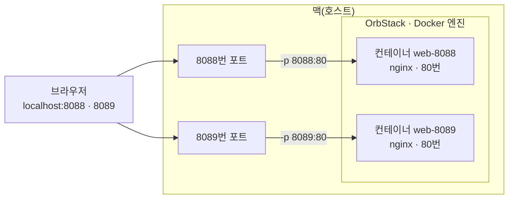
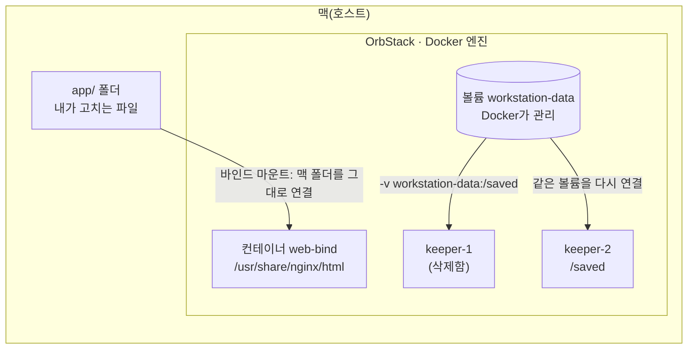

# e1-1-workstation

코디세이 E1-1 미션 「내 컴퓨터에 개발자용 '작업실' 꾸미기」 — 터미널 · 권한 · Docker · Git을 내 맥에서 직접 세팅하고, 실행 결과(로그 · 접속 · 데이터 유지)로 검증한 기록.

## 목차

1. [프로젝트 개요](#1-프로젝트-개요)
2. [실행 환경](#2-실행-환경)
3. [수행 체크리스트](#3-수행-체크리스트)
4. [터미널 조작 로그](#4-터미널-조작-로그)
5. [권한 실습](#5-권한-실습)
6. [Docker 설치 점검](#6-docker-설치-점검)
7. [Docker 기본 운영](#7-docker-기본-운영)
8. [컨테이너 실습](#8-컨테이너-실습)
9. [커스텀 이미지](#9-커스텀-이미지)
10. [포트 매핑 접속](#10-포트-매핑-접속)
11. [바인드 마운트](#11-바인드-마운트)
12. [볼륨 영속성](#12-볼륨-영속성)
13. [Git 설정과 GitHub VSCode 연동](#13-git-설정과-github-vscode-연동)
14. [검증 방법 요약](#14-검증-방법-요약)
15. [트러블슈팅](#15-트러블슈팅)
16. [보안 점검](#16-보안-점검)
17. [설계 원칙과 환경 주의](#17-설계-원칙과-환경-주의)

## 1. 프로젝트 개요

- **목표**: 코드가 「내 컴퓨터에서만」 돌아가는 문제를 줄이고, 누가 실행해도 같은 결과가 나오는(재현 가능한) 개발 환경을 직접 꾸민다.
- **한 일**: 터미널로 작업 폴더와 권한을 정리하고, Docker(OrbStack)를 설치 · 점검한 뒤 컨테이너를 실행 · 관리했다. 웹 서버를 Dockerfile로 커스텀 이미지로 만들어 포트 매핑으로 접속하고, 바인드 마운트로 「변경 반영」, 볼륨으로 「데이터 영속성」을 확인했다. Git 설정과 GitHub · VSCode 연동까지 마쳤다.
- **재현 방법**: 저장소를 받아(`git clone https://github.com/pokpok25/e1-1-workstation.git`) 그 폴더로 들어간 뒤, 4절부터 순서대로 따라 치면 같은 결과를 볼 수 있다(맥 · OrbStack 기준 — 다른 환경은 17절).

```
e1-1-workstation/
├── README.md            ← 이 문서(모든 수행 로그와 증거)
├── Dockerfile           ← 커스텀 이미지 정의(9절)
├── app/
│   ├── index.html       ← 웹 서버가 보여 줄 페이지(9절)
│   └── bind-check.txt   ← 바인드 마운트 확인용(11절)
├── terminal-lab/        ← 터미널 · 권한 실습 폴더(4 · 5절)
└── docs/
    └── images/          ← 스크린샷(10 · 13절)
```

## 2. 실행 환경

| 항목 | 값 |
|---|---|
| OS | macOS [채움: sw_vers의 ProductVersion] |
| 셸 | [채움: zsh --version 결과] |
| 터미널 | [채움: echo $TERM_PROGRAM 결과] |
| Docker | [채움: docker --version 결과] (OrbStack) |
| Git | [채움: git --version 결과] |

로그의 `$`는 프롬프트를 줄여 적은 것이다(셸은 zsh).

<details>
<summary>확인 명령과 출력</summary>

```
$ sw_vers
<여기에 실제 출력 붙이기>
$ echo $SHELL
<여기에 실제 출력 붙이기>
$ zsh --version
<여기에 실제 출력 붙이기>
$ echo $TERM_PROGRAM
<여기에 실제 출력 붙이기>
$ docker --version
<여기에 실제 출력 붙이기>
$ git --version
<여기에 실제 출력 붙이기>
```

</details>

## 3. 수행 체크리스트

- [x] 터미널: 위치 · 목록 · 이동 · 생성 · 복사 · 이름변경 · 삭제 · 내용 확인 · 빈 파일 → [4절](#4-터미널-조작-로그)
- [ ] 권한: 파일 1개 · 디렉토리 1개 변경 전/후 → [5절](#5-권한-실습)
- [ ] Docker: 설치 점검 · 기본 운영 · 컨테이너 실습 → [6절](#6-docker-설치-점검) · [7절](#7-docker-기본-운영) · [8절](#8-컨테이너-실습)
- [ ] Dockerfile: 커스텀 이미지 빌드 · 실행 → [9절](#9-커스텀-이미지)
- [ ] 포트: `-p`로 두 포트 접속 → [10절](#10-포트-매핑-접속)
- [ ] 마운트: 바인드 마운트로 호스트 변경 반영 → [11절](#11-바인드-마운트)
- [ ] 볼륨: 컨테이너 삭제 뒤 데이터 유지 → [12절](#12-볼륨-영속성)
- [ ] Git: 사용자 정보 · 기본 브랜치 설정 → [13절](#13-git-설정과-github-vscode-연동)
- [ ] GitHub: VSCode 로그인 · 저장소 연동 → [13절](#13-git-설정과-github-vscode-연동)

## 4. 터미널 조작 로그

**이동 · 생성 · 현재 위치 · 목록**

```
$ cd ~/codyssey/e1-1-workstation
$ mkdir -p terminal-lab/backup
$ cd terminal-lab
$ pwd
/Users/jmac/codyssey/e1-1-workstation/terminal-lab
$ ls -la
total 0
drwxr-xr-x@ 3 jmac  staff   96 Nov  8 15:07 .
drwxr-xr-x@ 5 jmac  staff  160 Nov  8 15:07 ..
drwxr-xr-x@ 2 jmac  staff   64 Nov  8 15:07 backup
```

**빈 파일 생성 · 파일 내용 확인**

```
$ touch empty.txt
$ echo "my first terminal log" > memo.txt
$ cat memo.txt
my first terminal log
```
- touch - 수정 시각을 지금으로 바꿔줌 파일이 없을 경우 빈 파일 생성
- echo가 글자를 내보내고 리다이렉션 `>` 로 "my first terminal log" 적힌 memo.txt 생성
- cat 명령어로 memo.txt 의 내용인 "my first terminal log" 출력

**숨김 파일 포함 목록** — `ls`와 `ls -la` 비교

```
$ touch .hidden-note
$ ls
backup          empty.txt       memo.txt
$ ls -la
total 8
drwxr-xr-x@ 6 jmac  staff  192 Nov 10 16:55 .
drwxr-xr-x@ 5 jmac  staff  160 Nov  8 15:07 ..
-rw-r--r--@ 1 jmac  staff    0 Nov 10 16:55 .hidden-note
drwxr-xr-x@ 2 jmac  staff   64 Nov  8 15:07 backup
-rw-r--r--@ 1 jmac  staff    0 Nov 10 16:43 empty.txt
-rw-r--r--@ 1 jmac  staff   22 Nov 10 16:43 memo.txt
```
- `ls`에는 .hidden-note 이 보이지 않고 `ls -la`에는 보인다, -a 가 .으로 시작되는 숨겨진 파일도 모두 나타내게 한다
- `ls -la`에서 empty.txt 크기가 0 → 빈 파일이 만들어졌다

**복사 · 이동/이름변경 · 삭제**

```
$ cp memo.txt backup/
$ ls -la backup
total 8
drwxr-xr-x@ 3 jmac  staff   96 Nov 10 16:58 .
drwxr-xr-x@ 6 jmac  staff  192 Nov 10 16:55 ..
-rw-r--r--@ 1 jmac  staff   22 Nov 10 16:58 memo.txt
$ mv empty.txt blank.txt
$ ls -la
total 8
drwxr-xr-x@ 6 jmac  staff  192 Nov 10 20:04 .
drwxr-xr-x@ 5 jmac  staff  160 Nov  8 15:07 ..
-rw-r--r--@ 1 jmac  staff    0 Nov 10 16:55 .hidden-note
drwxr-xr-x@ 3 jmac  staff   96 Nov 10 16:58 backup
-rw-r--r--@ 1 jmac  staff    0 Nov 10 16:43 blank.txt
-rw-r--r--@ 1 jmac  staff   22 Nov 10 16:43 memo.txt
$ rm blank.txt
$ ls -la
total 8
drwxr-xr-x@ 5 jmac  staff  160 Nov 10 20:05 .
drwxr-xr-x@ 5 jmac  staff  160 Nov  8 15:07 ..
-rw-r--r--@ 1 jmac  staff    0 Nov 10 16:55 .hidden-note
drwxr-xr-x@ 3 jmac  staff   96 Nov 10 16:58 backup
-rw-r--r--@ 1 jmac  staff   22 Nov 10 16:43 memo.txt
```
- cp : backup 폴더 안에 memo.txt 복사본이 생겼고 원본과 용량이 같다.
- mv : empty.txt가 blank.txt로 바뀌었다 → 같은 폴더 안에서 mv는 이름 바꾸기
- rm : 지운 뒤 blank.txt 줄이 목록에서 사라졌다

**이동 전후 위치**

```
$ cd backup
$ pwd
/Users/jmac/codyssey/e1-1-workstation/terminal-lab/backup
$ cd ..
$ pwd
/Users/jmac/codyssey/e1-1-workstation/terminal-lab
```

- 두 pwd의 끝이 `terminal-lab/backup`에서 `terminal-lab`으로 바뀌었다 → `cd backup` · `cd ..`은 지금 위치를 기준으로 움직이는 **상대 경로**이고, pwd가 보여 주는 `/`부터 시작하는 경로는 어디서 써도 같은 곳을 가리키는 **절대 경로**다.

## 5. 권한 실습

**파일 1개 — 실행 권한 주기**(`terminal-lab` 안에서)

```
$ echo '#!/bin/sh' > hello.sh
$ echo 'echo hello from script' >> hello.sh
$ ls -l hello.sh
<여기에 실제 출력 붙이기>
$ ./hello.sh
<여기에 실제 출력 붙이기>
$ chmod 755 hello.sh
$ ls -l hello.sh
<여기에 실제 출력 붙이기>
$ ./hello.sh
<여기에 실제 출력 붙이기>
```

**디렉토리 1개 — 나만 쓰게 바꾸기**

```
$ ls -ld backup
<여기에 실제 출력 붙이기>
$ chmod 700 backup
$ ls -ld backup
<여기에 실제 출력 붙이기>
```

| 숫자 | 글자 | 뜻 |
|---|---|---|
| `644` | `rw-r--r--` | 소유자 6(r+w) · 그룹 4(r) · 기타 4(r) |
| `755` | `rwxr-xr-x` | 소유자 7(r+w+x) · 그룹 5(r+x) · 기타 5(r+x) |
| `700` | `rwx------` | 소유자만 읽기 · 쓰기 · 들어가기(디렉토리의 x = 안으로 들어감) |

r=4 · w=2 · x=1을 소유자 · 그룹 · 기타 세 자리로 더한다.

## 6. Docker 설치 점검

OrbStack 앱을 켜면 Docker 엔진이 함께 실행되고, 터미널에서 `docker` 명령을 그대로 쓴다.

```
$ docker --version
<여기에 실제 출력 붙이기>
```

<details>
<summary>docker info — 데몬 동작 확인(Server 부분)</summary>

```
$ docker info
<여기에 실제 출력 붙이기>
```

</details>

## 7. Docker 기본 운영

**이미지 받기 · 목록**

<details>
<summary>docker pull 출력</summary>

```
$ docker pull nginx:alpine
<여기에 실제 출력 붙이기>
```

</details>

```
$ docker images
<여기에 실제 출력 붙이기>
```

**컨테이너 실행 · 목록 · 로그 · 자원 · 중지**

```
$ docker run -d --name ops-nginx nginx:alpine
<여기에 실제 출력 붙이기>
$ docker ps
<여기에 실제 출력 붙이기>
```

<details>
<summary>docker logs 출력</summary>

```
$ docker logs ops-nginx
<여기에 실제 출력 붙이기>
```

</details>

```
$ docker stats --no-stream
<여기에 실제 출력 붙이기>
$ docker stop ops-nginx
<여기에 실제 출력 붙이기>
$ docker ps -a
<여기에 실제 출력 붙이기>
```

## 8. 컨테이너 실습

**hello-world**

<details>
<summary>docker run hello-world 출력</summary>

```
$ docker run hello-world
<여기에 실제 출력 붙이기>
```

</details>

**ubuntu 안에서 명령**

```
$ docker run -it --name ubuntu-try ubuntu bash
<여기에 실제 화면 붙이기>
```

**attach와 exec 관찰**

```
$ docker run -dit --name ubuntu-keep ubuntu bash
<여기에 실제 출력 붙이기>
$ docker exec -it ubuntu-keep bash
<여기에 실제 화면 붙이기>
$ docker ps
<여기에 실제 출력 붙이기>
$ docker attach ubuntu-keep
<여기에 실제 화면 붙이기>
$ docker ps -a
<여기에 실제 출력 붙이기>
```

| 해 본 것 | 본 것 | 내 해석 |
|---|---|---|
| `exec`로 들어갔다가 `exit` | [채움] | [채움] |
| `attach`로 붙었다가 `exit` | [채움] | [채움] |

## 9. 커스텀 이미지

| 항목 | 내용 |
|---|---|
| 방식 | (A) 웹 서버 베이스 이미지 + 정적 콘텐츠 교체 |
| 베이스 | `nginx:alpine` — [채움: 고른 이유] |
| 웹 서버 소스 | [`app/index.html`](app/index.html) |

**Dockerfile(직접 작성)** — 저장소 맨 위 폴더에서

```
$ cd ~/codyssey/e1-1-workstation
$ cat Dockerfile
<여기에 실제 출력 붙이기>
```

| 커스텀 포인트(줄) | 목적 |
|---|---|
| [채움] | [채움] |

**빌드 · 확인**

<details>
<summary>docker build 출력</summary>

```
$ docker build -t pokpok-web:1.0 .
<여기에 실제 출력 붙이기>
```

</details>

```
$ docker images pokpok-web
<여기에 실제 출력 붙이기>
```

## 10. 포트 매핑 접속

`-p 8088:80` = 맥(호스트)의 8088번으로 들어온 요청을 컨테이너 안 nginx가 듣는 80번으로 넘긴다.



컨테이너는 둘 다 안에서 같은 80번을 쓰지만, 맥 쪽 포트(8088 · 8089)가 달라서 부딪히지 않는다.

```
$ docker run -d -p 8088:80 --name web-8088 pokpok-web:1.0
<여기에 실제 출력 붙이기>
$ docker ps
<여기에 실제 출력 붙이기>
$ curl http://localhost:8088
<여기에 실제 출력 붙이기>
```


**다른 호스트 포트로 한 번 더**

```
$ docker run -d -p 8089:80 --name web-8089 pokpok-web:1.0
<여기에 실제 출력 붙이기>
$ curl http://localhost:8089
<여기에 실제 출력 붙이기>
```


## 11. 바인드 마운트

맥의 `app/` 폴더를 컨테이너의 웹 폴더에 그대로 연결한다. 다시 빌드하지 않고 맥에서 파일만 고쳐도 응답이 바뀌는지 본다(저장소 맨 위 폴더에서).

**바인드 마운트(11절)와 볼륨(12절) 비교**



- 바인드 마운트 = 맥에 있는 폴더를 그대로 연결 → 맥에서 고치면 컨테이너에 바로 보인다.
- 볼륨 = Docker가 관리하는 저장 공간 → 컨테이너를 지워도 남아서 새 컨테이너가 이어 쓴다.

```
$ echo "version 1 - before edit" > app/bind-check.txt
$ docker run -d -p 8090:80 -v "$(pwd)/app":/usr/share/nginx/html --name web-bind pokpok-web:1.0
<여기에 실제 출력 붙이기>
$ curl http://localhost:8090/bind-check.txt
<여기에 실제 출력 붙이기>
$ echo "version 2 - edited on host" > app/bind-check.txt
$ curl http://localhost:8090/bind-check.txt
<여기에 실제 출력 붙이기>
```

## 12. 볼륨 영속성

**생성**

```
$ docker volume create workstation-data
<여기에 실제 출력 붙이기>
$ docker volume ls
<여기에 실제 출력 붙이기>
```

**연결 · 쓰기 · 삭제 전 확인**

```
$ docker run -d --name keeper-1 -v workstation-data:/saved ubuntu sleep infinity
<여기에 실제 출력 붙이기>
$ docker exec keeper-1 sh -c "echo 'written by keeper-1' > /saved/note.txt"
$ docker exec keeper-1 cat /saved/note.txt
<여기에 실제 출력 붙이기>
```

**컨테이너 삭제 → 볼륨은 남았나 → 새 컨테이너에서 확인**

```
$ docker rm -f keeper-1
<여기에 실제 출력 붙이기>
$ docker ps -a
<여기에 실제 출력 붙이기>
$ docker volume ls
<여기에 실제 출력 붙이기>
$ docker run -d --name keeper-2 -v workstation-data:/saved ubuntu sleep infinity
<여기에 실제 출력 붙이기>
$ docker exec keeper-2 cat /saved/note.txt
<여기에 실제 출력 붙이기>
```

## 13. Git 설정과 GitHub VSCode 연동

Git은 내 맥에서 파일 변경 이력을 기록하는 **로컬 버전 관리 도구**이고, GitHub는 그 저장소를 인터넷에 올려 공유 · 협업하는 **원격 저장소 플랫폼**이다. `git commit`은 맥 안에 기록하고, `git push`가 GitHub로 보낸다.

**설정 명령** — 이 맥은 개인 계정과 학습용 계정을 함께 쓰므로, 학습용 설정을 따로 파일(`~/.gitconfig-codyssey`)에 두고 `~/codyssey/` 아래 저장소에서만 읽히게 했다(일반 PC라면 17절).

```
$ git config --file ~/.gitconfig-codyssey user.name "pokpok25"
$ git config --file ~/.gitconfig-codyssey user.email "jgj2500000@gmail.com"
$ git config --file ~/.gitconfig-codyssey init.defaultBranch main
$ git config --global "includeIf.gitdir:~/codyssey/.path" ~/.gitconfig-codyssey
```

**설정 결과**(저장소 폴더 안에서)

<details>
<summary>git config --list 출력</summary>

```
$ git config --list
<여기에 실제 출력 붙이기>
```

</details>

<details>
<summary>git config --list --show-origin 출력 — 값마다 어느 설정 파일에서 왔는지</summary>

```
$ git config --list --show-origin
<여기에 실제 출력 붙이기>
```

</details>

**원격 저장소 연동**

```
$ git remote -v
<여기에 실제 출력 붙이기>
$ git status -sb
<여기에 실제 출력 붙이기>
$ git push
<여기에 실제 출력 붙이기>
```

| VSCode GitHub 로그인(계정 메뉴) | VSCode 소스 제어 연동 |
|---|---|
|  |  |

## 14. 검증 방법 요약

| 항목 | 확인 명령 | 성공이면 보이는 것 | 증거 |
|---|---|---|---|
| 터미널 | `pwd` · `ls -la` | 현재 경로 · 숨김 파일 `.hidden-note` | [4절](#4-터미널-조작-로그) |
| 권한 | `ls -l` · `ls -ld` | 변경 전/후 권한 글자가 다름 | [5절](#5-권한-실습) |
| Docker 점검 | `docker info` | `Server:` 정보가 나옴(데몬 동작) | [6절](#6-docker-설치-점검) |
| 기본 운영 | `docker ps -a` | 멈춘 컨테이너가 `Exited` | [7절](#7-docker-기본-운영) |
| 컨테이너 | `docker ps -a` | attach 뒤 `exit`한 컨테이너 상태 | [8절](#8-컨테이너-실습) |
| 커스텀 이미지 | `docker images pokpok-web` | 내 이미지 `pokpok-web:1.0` | [9절](#9-커스텀-이미지) |
| 포트 매핑 | `curl http://localhost:8088` | 내 페이지 HTML | [10절](#10-포트-매핑-접속) |
| 바인드 마운트 | `curl http://localhost:8090/bind-check.txt` | 다시 빌드 없이 내용이 바뀜 | [11절](#11-바인드-마운트) |
| 볼륨 | `docker exec keeper-2 cat /saved/note.txt` | 삭제 전과 같은 내용 | [12절](#12-볼륨-영속성) |
| Git · GitHub | `git config --list` · `git remote -v` | 사용자 · 기본 브랜치 · origin 주소 | [13절](#13-git-설정과-github-vscode-연동) |

## 15. 트러블슈팅

### 1) [채움: 실제로 겪은 문제 제목]

| 단계 | 내용 |
|---|---|
| 문제 | [채움: 무엇을 했더니 무엇이 나왔나 — 에러 원문] |
| 원인 가설 | [채움] |
| 확인 | [채움: 명령 + 출력] |
| 해결/대안 | [채움] |

### 2) [채움: 실제로 겪은 문제 제목]

| 단계 | 내용 |
|---|---|
| 문제 | [채움] |
| 원인 가설 | [채움] |
| 확인 | [채움] |
| 해결/대안 | [채움] |

## 16. 보안 점검

- 커밋 · `git config` 출력에 보이는 메일은 학습 전용 계정의 메일이라 공개로 두었다.
- 스크린샷: [채움: 마지막 점검 뒤 — 토큰 · 인증 코드가 보이는지 확인한 결과]
- 저장소 전체(지난 커밋 포함) 검색: [채움: 마지막 점검 뒤 결과]

```
$ git grep -nE 'gh[pousr]_|github_pat_|BEGIN [A-Z ]*PRIVATE KEY|password' -- . ':!README.md'
<여기에 실제 출력 붙이기>
$ git log -p --all -- . ':!README.md' | grep -nE 'gh[pousr]_|github_pat_|BEGIN [A-Z ]*PRIVATE KEY|password'
<여기에 실제 출력 붙이기>
$ grep -nE 'gh[pousr]_|github_pat_|BEGIN [A-Z ]*PRIVATE KEY|password' README.md
<여기에 실제 출력 붙이기>
```

첫째 · 둘째 줄은 아무것도 안 나오면 0건이다. 셋째 줄은 README 안의 이 검색 명령 줄만 걸려야 한다.

## 17. 설계 원칙과 환경 주의

**왜 이렇게 하나**

| 원칙 | 이유 |
|---|---|
| 이미지와 컨테이너 분리 | 이미지는 실행 환경을 담은 읽기 전용 틀이고 컨테이너는 그 틀로 띄운 실행 단위다. 틀이 같으니 몇 번을 띄워도 같은 환경이 재현된다. |
| 격리 | 컨테이너는 자기만의 파일 시스템 · 프로세스 공간에서 돌아서, 내 맥 설치 상태와 다른 컨테이너에 영향을 주지 않는다. |
| 포트 연결 | 컨테이너 안의 포트는 밖에서 보이지 않으므로 `-p 호스트:컨테이너`로 맥의 포트와 이어 줘야 접속할 수 있다. |
| 스토리지 연결 | 컨테이너를 지우면 안의 데이터도 사라지므로, 고치면서 볼 파일은 바인드 마운트로, 지켜야 할 데이터는 볼륨으로 컨테이너 밖에 둔다. |

**환경 주의**(이 README는 macOS + OrbStack 기준)

- OrbStack 앱이 켜져 있어야 `docker` 명령이 동작한다. 리눅스라면 Docker Engine을 설치하고 데몬을 켠다.
- OS 버전: 맥은 `sw_vers`, 리눅스는 `cat /etc/os-release`.
- 경로: 맥 홈은 `/Users/<사용자>`, 리눅스는 `/home/<사용자>` — 4 · 9 · 11절의 경로는 자기 저장소 위치에 맞춰 읽는다.
- Git 설정: 13절은 계정 둘을 나눈 이 맥의 방식이다. 계정이 하나인 일반 PC라면 `git config --global user.name "<이름>"` · `git config --global user.email "<메일>"` · `git config --global init.defaultBranch main` 세 줄이면 된다.
- `ls -l`의 권한 끝 `@`는 맥의 확장 속성 표시라 리눅스에선 안 보인다.
